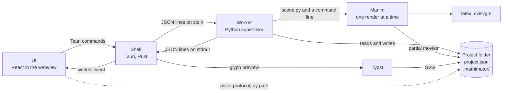

# Architecture overview

Mathimator turns a small JSON document, a project, into a
[Manim Community](https://www.manim.community/) scene, renders it, and plays
the result back in a desktop window. This page shows the moving parts and how
a document becomes a movie. The other pages in this folder go into each part.

The normative rules live in [the design spec](../design-spec.md). This page
describes how the code carries them out.

## Three processes

Mathimator runs as three long-lived processes, plus short-lived children:

| Process | Code | Language | What it owns |
| --- | --- | --- | --- |
| **UI** | [`desktop/src`](../../desktop/src) | TypeScript, React 19, built by Vite | What the user sees: the selection, unsaved field drafts, the playhead, playback, which panel is open, and which jobs it is waiting for |
| **Shell** | [`desktop/src-tauri`](../../desktop/src-tauri) | Rust, Tauri 2 | The window, the worker process (spawn, handshake, request order, timeouts, restarts), the bundled runtime, temp projects, the TeX self-test, the equation glyph preview, and the logs |
| **Worker** (the supervisor) | [`worker/mathimator_worker`](../../worker/mathimator_worker) | Python, standard library only | The document, undo and redo, the project folder and its lock, the generated scene code, the render queue, the preview index and the exports |

The short-lived children are:

- **Manim**, one process per render job, started by the worker. It is a
  fresh Python interpreter each time, because Manim's configuration is global
  to its process. At most one runs at a time.
- **`latex` and `dvisvgm`**, started by Manim for formulas and axis labels,
  and once per launch by the shell's TeX self-test.
- **Typst**, started by the shell to draw the live glyph of the formula being
  edited. Manim never uses it.

The worker never imports Manim, PyAV or any other third-party package. It
writes `scene.py`, starts Manim as a separate program, and follows the render
through the files Manim writes. This keeps the worker small, fast to start,
and safe from a crash inside Manim's native code: a failed render ends the
job, not the worker.

## How they talk



- **UI to shell.** The UI calls Tauri commands with `invoke`. A command that
  needs the worker returns the worker's reply unchanged, refusals included.
  The shell's own failures reject the call with `{code, message}`. The full
  list is in [the shell page](shell.md#tauri-commands).
- **Shell to UI.** One Tauri event, `worker-event`, carries every worker line
  that no request is waiting for (job progress, late replies) and three lines
  of the shell's own: `worker_exited`, `notice` and `tex_status`.
- **Shell to worker.** UTF-8 JSON, one object per line, on the worker's stdin;
  replies and job events come back the same way on its stdout. The worker's
  stderr is diagnostics only, and the shell appends it to `supervisor.err`.
  [The protocol page](protocol.md) walks through it.
- **Worker to Manim.** A command line, an environment, and the scene file in
  `.mathimator/codegen/`. Progress comes from the partial movies Manim writes,
  never from its console output.
- **Files cross by path.** No frame or movie is sent over a pipe. The worker
  sends absolute paths inside the project folder, and the UI reads them
  through Tauri's asset protocol, whose scope the shell widens to each project
  folder a `state` line names.

Requests are strictly ordered. The UI sends every worker-bound command through
one queue ([`workerQueue.ts`](../../desktop/src/workerQueue.ts)), the shell
writes one request at a time behind a request gate
([`worker.rs`](../../desktop/src-tauri/src/worker.rs)), and the worker answers
each request before it reads the next one. So the UI applies answers in the
order it asked.

## Where state lives

| State | Kept by | Others hold |
| --- | --- | --- |
| The document, undo and redo, dirty flags, the preview index, the render records | Worker | The UI keeps the last `state` reply it applied |
| The project binding, the project lock, the disk fingerprint of `project.json`, the folder identity | Worker | The shell mirrors `projectPath` for the asset scope, the last project and the glyph folder |
| The render queue: the running job and the held export and preview | Worker | The shell hands out job ids |
| The worker process, the request gate, timeouts, restarts | Shell | |
| Temp projects, the last project, pruning, the leave warnings, one dialog at a time | Shell | |
| Runtime paths, TeX status, notices, logs | Shell | The UI shows notices and the TeX warning; the worker keeps the TeX error it was last given |
| The glyph preview: translator, Typst, the newest request per formula | Shell | The UI owns the request counter |
| Selection, drafts, playhead, playback, open panels, the job handshake, the status line | UI | |

## From project.json to a movie

A project is a folder. `project.json` is the document; everything under
`.mathimator/` is derived from it, except the lock.

```text
<project>/
  project.json                   the document
  .mathimator/
    lock                         held while a worker has the project open
    temp-project.json            the shell's marker, in temp projects only
    codegen/scene.py             the generated scene
    cache/media/                 Manim's media folder: partial movies, movies, TeX
    cache/last-good/             the previous clip of each beat that is out of date
    cache/preview-index.json     each beat's preview files
    cache/rendered.json          the beat keys of the last full preview
    cache/manim-run.json         only while Manim runs
    exports/<key16>/             a published export and its export.json
    equation/                    the glyph preview's .typ and .svg files
    logs/worker.log              the worker's log, rotated at 5 MB
```

This is what happens when the user edits a field and the preview updates:

1. **The UI builds an edit.** An Inspector field builds an edit object with a
   builder from [`edits.ts`](../../desktop/src/edits.ts), such as
   `{op: "set_latex", objectId: "eq_1", latex: "y = \\sin(2x)"}`, and
   `useEditor` queues a task that calls the `edit_document` command.
2. **The shell forwards it.** It writes
   `{"cmd": "edit", "id": "rpc-12", "edit": {...}}` to the worker's stdin and
   waits up to 30 seconds for the line whose `jobId` is `rpc-12`.
3. **The worker applies it.** The session applies the edit to a copy of the
   document and reads the copy back through the full validator, so an edit
   can never leave an invalid document. If the saved bytes would change, the
   worker checks that the folder and `project.json` are as it last left them,
   writes `project.json` atomically, and only then commits one undo step. It
   rebuilds the preview index and answers with a `state` line: the document,
   the derived start times, dirty flags and on-screen sets, the preview index,
   and the generated `scene.py`.
4. **The UI applies the reply.** It replaces its copy of the state, marks the
   current preview as stale, and after a 300 ms debounce queues a preview.
5. **The preview starts.** The UI reserves a job id (`preview-13`) from the
   shell, records it, and calls `render_preview`. A job gets no reply line;
   its lines arrive as `worker-event`s.
6. **The worker prepares the job.** Under its document lock it repeats the
   disk checks, refuses links among its folders, generates the scene, checks
   that TeX is available when the scene needs it and that the project path can
   render, writes a fresh `.mathimator/codegen/scene.py`, copies the files of
   out-of-date beats to `last-good/`, and builds Manim's command line.
7. **Manim renders.** The worker starts Manim in the codegen folder, puts it in
   a kill-on-close Job Object on Windows, and sends `started`. Manim reuses
   the partial movie of every beat whose code is unchanged and renders the
   rest, one beat after another.
8. **Beats arrive one by one.** Every 0.1 s the worker looks for partial movies
   Manim has finished. Each complete one is recorded in the preview index and
   sent as `beat_ready {beatIndex, path}`, which the UI patches into its copy
   of the index so the canvas can show that beat at once.
9. **The job ends.** When Manim exits 0, the segment list it wrote gives every
   beat's clip in order. The worker records them, notes which beat keys the
   preview was rendered from, and sends `done {path}` with the full preview
   movie. The UI asks for `get_state` and applies the settled index.
10. **Playback.** The canvas picks the file under the playhead with
    `playbackAt` in [`playback.ts`](../../desktop/src/playback.ts): the full
    movie when every beat is fresh, otherwise the beat's own clip, or its last
    good clip under the "Preview is out of date" badge.

An export runs the same way with three differences. The UI first saves the
export profile with an ordinary `set_export_profile` edit. The render uses the
export's size, frame rate and format, and sends no `beat_ready`. When Manim
finishes, the worker copies the result into `.mathimator/exports/<key16>/`
with an `export.json` that records its export key, and sends
`done {path, current}`. An export whose key is already published is answered
with `done` at once, without starting Manim.

[Rendering and caching](rendering-and-caching.md) explains how the scene code
is generated, why an edit to one beat rerenders only that beat and the ones
after it, and how the worker tells a finished clip from a cut-off one.

## Repository map

| Path | Contents |
| --- | --- |
| [`worker/mathimator_worker`](../../worker/mathimator_worker) | The worker package. See [the worker page](worker.md) |
| [`desktop/src-tauri`](../../desktop/src-tauri) | The Rust shell and its Tauri configuration. See [the shell page](shell.md) |
| [`desktop/src`](../../desktop/src) | The UI. See [the UI page](ui.md) |
| [`tests`](../../tests) | The pytest suite, and in [`tests/fixtures`](../../tests/fixtures) the sample projects and the fixtures the Python, Rust and TypeScript tests share |
| [`scenes`](../../scenes) | Scene code that tests render or compare byte for byte |
| [`packaging`](../../packaging) | The runtime bundle build and its pins. See [packaging and release](packaging-and-release.md) |
| [`scripts`](../../scripts) | The version check, the bundle check and the notices generator, with their tests |
| [`ci`](../../ci) | Helper scripts for the GitHub Actions workflows, and tests that hold the workflows and documents to the code |
| [`.github`](../../.github) | Workflows, Dependabot, code owners and templates |

## Rules that shape the code

A few decisions explain much of what the code does:

- **A project is untrusted data.** A project may come from someone else, so
  opening, previewing or exporting it must not run code or read files of its
  author's choosing. Expressions follow a fixed grammar and are translated,
  never evaluated. Formula LaTeX is limited to an allowlist of math commands.
  None of Mathimator's own folders in a project may be a symbolic link or a
  junction, and no delete ever follows a link.
- **Every change is all or nothing.** An edit is checked whole and saved
  before it is committed, a failed save leaves the document as it was, and an
  unexpected exception in the worker is answered with `error internal` while
  the worker keeps serving.
- **Durations are the source of truth.** Beat start times are derived and never
  stored, so moving or resizing a beat cannot leave inconsistent times.
- **One Manim at a time.** A new preview or an export cancels a running
  preview and takes its place, a preview waits behind a running export, and
  nothing renders in parallel.
- **Windows first.** Process control uses Job Objects, paths are checked for
  what `dvisvgm` and Windows can handle, and the project lock holds an open
  folder like a document open in an editor. Linux runs the tests and the
  development build; macOS is untested.
