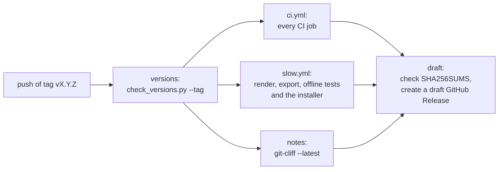

# Packaging and release

Mathimator ships as one offline Windows installer. The installer holds the
Tauri app and a **runtime bundle**: a relocatable CPython with Manim, TinyTeX,
Typst, the worker and a sample project, so the app needs nothing installed
beside it and never downloads anything. This page describes how the bundle is
built and checked, what the installer is, and how a release is made.

[README.md](../../README.md#building-the-installer) has the commands, and
[CONTRIBUTING.md](../../CONTRIBUTING.md#releases) the release steps. Section 8
of [the design spec](../design-spec.md) states the rules.

## The runtime bundle

[`packaging/build-bundle.ps1`](../../packaging/build-bundle.ps1) builds the
bundle in `packaging/bundle`, which the installer ships as its `runtime`
folder:

| Entry | Contents |
| --- | --- |
| `python/` | A relocatable CPython from python-build-standalone, with the `render` group of `uv.lock` installed into it: `manim[typst]` and its locked dependencies, PyAV with FFmpeg's libraries among them |
| `tinytex/` | TinyTeX with the LaTeX packages Manim's `MathTex` template needs, installed from a dated TeX Live snapshot, then cut off from the network |
| `typst/` | The Typst binary for the glyph preview, with its `LICENSE` and `NOTICE` |
| `worker/` | A copy of `worker/mathimator_worker` |
| `samples/reference-60/project.json` | The sample that Sample opens |
| `runtime.json` | Where each part is, and what it was built from |
| `THIRD_PARTY_NOTICES.txt` | Written afterwards by `scripts/generate_notices.py` |

The bundled interpreter is a real CPython, not a virtual environment, so the
installed app works on any account and runs Manim without a venv launcher.

### Pins

[`packaging/versions.env`](../../packaging/versions.env) pins every tool the
build downloads, as plain `KEY=VALUE` lines that both build scripts read:

- `UV_VERSION`, which also pins the CPython builds uv installs and checks;
- `PYTHON_VERSION` and `PYTHON_FALLBACK_VERSION`: the build uses the fallback
  only when a package in `uv.lock` has no wheel for the main version, and
  records why;
- `TINYTEX_VERSION` and `TLNET_REPOSITORY`, the dated TeX Live snapshot that
  tlmgr installs packages from, so a rebuild gets the same package revisions;
- `TYPST_VERSION`.

Each download for Windows and for Linux has its SHA-256 in the file. The
build checks it after the download and again when it reuses a cached copy in
`packaging/.cache`, and it stops at a download with no pinned hash. To bump a
tool, download and check the new asset, then change its version and hashes
together.

The Python render stack has one source: `uv.lock`. Development, CI and the
bundle all install the same versions with the same hashes.

### The build, step by step

`build-bundle.ps1` logs every step to `out/bundle.log`. It:

1. Deletes `runtime.json` and the notices of an older build, so a half-built
   bundle can never pass for a finished one.
2. Downloads uv and installs CPython into `python/`.
3. Exports the `render` group of `uv.lock` with its hashes and installs it
   into the bundled interpreter, wheels only. A package that publishes no
   wheel at all is built from its sdist with the build backend the lock pins.
   If a package has no wheel for the main Python version, the build starts
   again with the fallback version.
4. Extracts TinyTeX, points tlmgr at the pinned snapshot, updates tlmgr, and
   installs the seed packages (`standalone`, `preview`, `babel`,
   `babel-english`, `amsmath`, `amsfonts` and `dvisvgm`). It compiles a
   one-line formula to SVG as a warm-up, then points tlmgr at
   `https://offline.invalid/tlnet`, a name that never resolves, and checks that
   installing another package now fails.
5. Copies Typst with its licence files and checks `typst --version`.
6. Copies the worker and the sample.
7. Checks that the bundled interpreter, started with `-I`, imports Manim
   entirely from inside the bundle.
8. Compiles the bundled Python and the worker with `compileall` into
   checked-hash bytecode, in one process so every build gives the same bytes,
   with each source recorded as `runtime\...` rather than by its build path.
   The installer puts the runtime under Program Files, where Python run by a
   standard user cannot write bytecode, so without this every start would
   compile the standard library and the render stack again. Python checks each
   `.pyc` against the hash of its source, so a stale one never runs.
9. Runs `scripts/check_bundle.py --prune`, which removes stray top-level
   entries and any bytecode the build did not compile.
10. Writes `runtime.json` last, and logs the size of each entry and of the
    whole bundle.

`runtime.json` holds the paths the shell reads (`platform`, `python`,
`worker`, `sample`, `typst`, `tinytexBin`) and the build's provenance
(`pythonVersion`, `pythonSelection`, `manim`, `lockSha256`, `typstVersion`,
`tinytexVersion`, `tinytexRelease` and `tlnetRepository`). The shell's
[runtime resolution](shell.md#runtime-resolution) describes how a release build
uses it.

[`packaging/build-bundle.sh`](../../packaging/build-bundle.sh) runs the
PowerShell script from Git Bash, MSYS2 or Cygwin. On Linux it builds a
`linux-x86_64` bundle by the same recipe, for the offline tests. There is no
Linux installer.

## Checking the bundle

[`scripts/check_bundle.py`](../../scripts/check_bundle.py) has two modes.

`check_bundle.py --prune` runs inside the build, before `runtime.json` is
written. It removes top-level entries outside the layout (such as a crash dump
or an older build's venv) and everything in a `__pycache__` folder except the
bytecode the build compiled. It removes a link itself and never enters one.

`check_bundle.py` with no flag checks a finished bundle and changes nothing.
It fails unless:

- `runtime.json` names this machine's platform, its paths lie inside the
  bundle, and `python` is a real interpreter, not a venv launcher;
- `lockSha256` is the SHA-256 of `uv.lock`, and the Python, Typst, TinyTeX and
  snapshot versions match `packaging/versions.env`;
- the worker and the sample equal their sources byte for byte;
- `THIRD_PARTY_NOTICES.txt` records the SHA-256 of this checkout's `uv.lock`,
  `Cargo.lock` and `package-lock.json`, so the notices were written for these
  dependencies;
- nothing lies outside the layout, and every `__pycache__` holds only
  checked-hash bytecode of a source beside it.

Both modes fail on a link that leaves the bundle, and on any file, bytecode
included, that names the checkout or a path in the builder's home folder. A
stale, incomplete or foreign bundle never reaches an installer.

## Third-party notices

[`scripts/generate_notices.py`](../../scripts/generate_notices.py) writes
`THIRD_PARTY_NOTICES.txt` from the built bundle. It lists, each with its
version and declared licence:

- the bundled CPython, the shared libraries it ships and those linked into it;
- every Python distribution in its `site-packages`, from the `.dist-info`
  metadata and licence files;
- the FFmpeg, x264, x265 and other libraries that PyAV ships, with the FFmpeg
  build's licence and configure line read from the library, and a written
  offer of their source;
- Typst, and TinyTeX with every TeX Live package in its package database;
- the Rust crates the shell links, from `cargo metadata` (run offline, so the
  crates must be fetched first);
- the npm packages the UI bundles, from `desktop/package-lock.json` and
  `desktop/node_modules`;
- Microsoft's WebView2 Runtime, whose offline installer the installer embeds.

Each distinct licence text is printed once and cited by number. A component
that ships no licence file gets the standard text of its licence from
[`packaging/licenses`](../../packaging/licenses). The native libraries are
listed in tables kept by hand in the script, and the script fails on a library
no table names, so a new native library is reviewed before an installer ships
it. The output holds no absolute path and no date, so the same inputs give the
same bytes. The script refuses a Linux bundle, because its tables list only
the libraries the Windows CPython links in.

The app's Notices panel shows a short summary and then this file, which the
shell reads from the installed runtime.

## The installer

The installer is a Tauri NSIS bundle, configured in
[`tauri.windows.conf.json`](../../desktop/src-tauri/tauri.windows.conf.json):

- It installs for all users under Program Files (`installMode: perMachine`),
  so installing needs administrator rights.
- It ships `packaging/bundle` as the `runtime` resource folder.
- It embeds Microsoft's WebView2 offline installer and runs it silently on a
  PC that lacks the WebView2 runtime.
- Its `beforeBundleCommand` runs `generate_notices.py` and then
  `check_bundle.py` with the bundled interpreter, after the cargo build and
  before the installer is made. So `npm run tauri build` fails on a missing or
  stale bundle even when it is run on its own.

[`ci/package-windows.ps1`](../../ci/package-windows.ps1) builds an installer as
a release does: it builds the bundle, runs `npm ci` and `cargo fetch`, writes
and checks the notices (so a bad bundle fails in seconds rather than after the
cargo build), runs `tauri build`, and copies the installer and
`THIRD_PARTY_NOTICES.txt` into `out/package` with a `SHA256SUMS` in the format
`sha256sum -c` reads.

### Signing

Installers are unsigned for now, but the hook is in place. When the
environment variable `WINDOWS_SIGN_COMMAND` is set, `package-windows.ps1`
passes it to `tauri build` as `bundle.windows.signCommand`, which signs the app
and the installer. In CI it comes from the repository variable of the same
name, which stays unset. A secret the signing tool needs goes in a repository
secret, which the installer job in `slow.yml` must map into its environment
and the release workflow must pass on, because a called workflow receives no
secrets by itself. The comments in `package-windows.ps1` give the details.

## Versions

One app version is written in several manifests: `worker/pyproject.toml`,
`mathimator_worker/__init__.py`, `desktop/package.json`, the shell's
`Cargo.toml` and `tauri.conf.json`, and the three lockfiles.
[`.bumpversion.toml`](../../.bumpversion.toml) lists them all, so
`uv run bump-my-version bump minor` (or `major`, or `patch`) changes every
copy at once. The root `pyproject.toml` is a development workspace, not the
app, and keeps `0.0.0`.

[`scripts/check_versions.py`](../../scripts/check_versions.py) fails CI when
the copies of the app version disagree, and when a toolchain pin disagrees
with its source:

| Pin | Must match |
| --- | --- |
| Rust channel in `rust-toolchain.toml` | `rust-version` in the shell's `Cargo.toml` |
| Node in `desktop/.nvmrc` | the one major `engines.node` allows in `package.json` |
| `.python-version` | `PYTHON_VERSION` in `versions.env` |
| uv's `required-version` in `pyproject.toml` | `UV_VERSION` in `versions.env` |
| `MANIM_VERSION` in `document.py` | the Manim pin of the root `pyproject.toml` |
| `TYPST_VERSION` in `versions.env` | the version the shell's `equation.rs` requires |

With `--tag`, as the release workflow runs it, the tag must be `v` followed by
the app version.

The pinned versions of Manim, Typst, CPython, uv, Rust, Node, Tauri, React and
Vite change only by hand, in every copy at once, and a change to one the spec
names is also a spec change. Dependabot proposes other dependency updates, and
its configuration ignores these.

## The release flow

A release is a pull request and a tag:

1. On a release branch, bump the version with bump-my-version, regenerate
   `CHANGELOG.md` with git-cliff
   (`uv run git-cliff --tag vX.Y.Z --output CHANGELOG.md`), and commit both.
   git-cliff reads the Conventional Commits history ([`cliff.toml`](../../cliff.toml)).
2. Merge the release pull request into `main` once CI passes.
3. A maintainer tags the merge commit `vX.Y.Z` and pushes the tag.

The tag starts [`release.yml`](../../.github/workflows/release.yml):

1. **versions** fails unless the tag is `v` followed by the app version and
   every pin agrees.
2. **ci** and **slow** call [`ci.yml`](../../.github/workflows/ci.yml) and
   [`slow.yml`](../../.github/workflows/slow.yml) for the tagged commit, so a
   tag runs every CI job, the render, export and offline suites against a
   freshly built bundle, and the installer build, which uploads the installer,
   `THIRD_PARTY_NOTICES.txt` and `SHA256SUMS` as an artifact.
3. **notes** writes the release notes with
   `git-cliff --latest --strip header`.
4. **draft**, the only job that may write to the repository, downloads the
   installer artifact and the notes, checks the files against `SHA256SUMS`, and
   creates a draft GitHub Release, "Mathimator vX.Y.Z", with the three files
   and the notes.

A maintainer reviews the draft and publishes it by hand. Users can check a
download against `SHA256SUMS`, as [SECURITY.md](../../SECURITY.md) describes.
